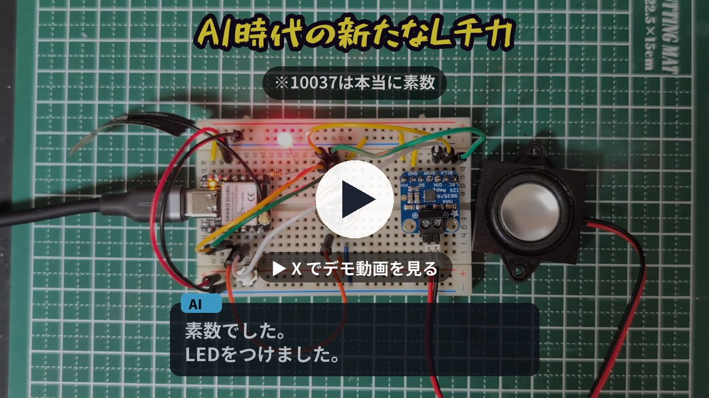
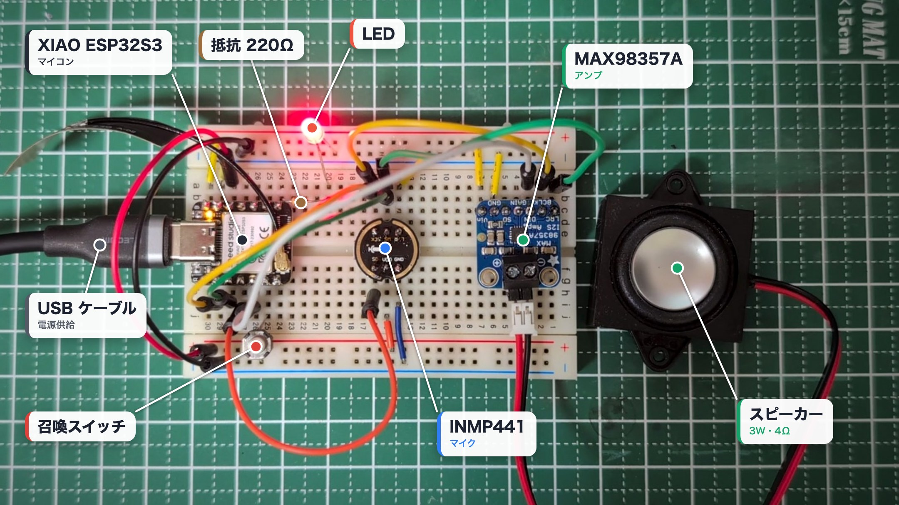
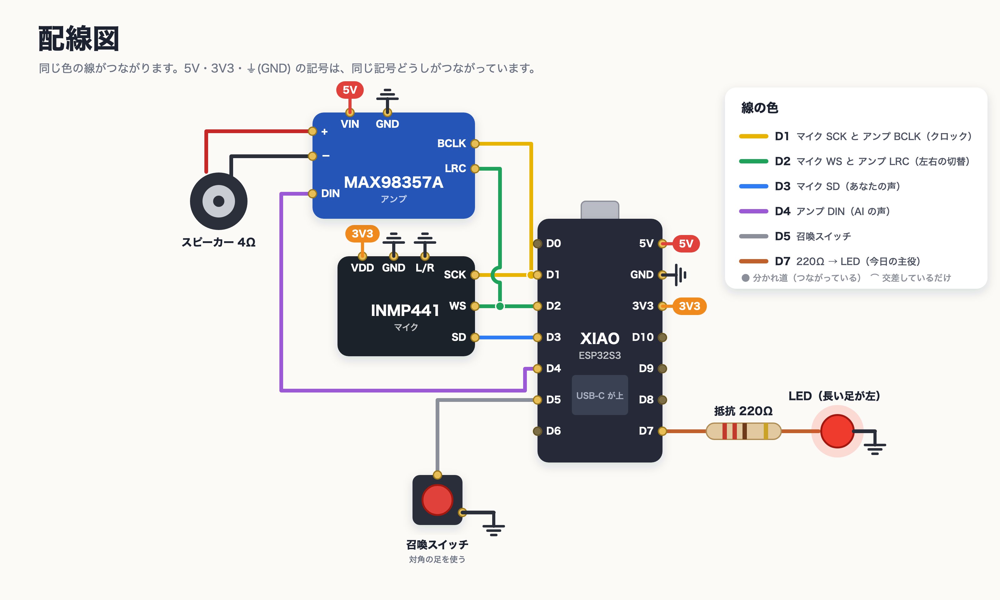
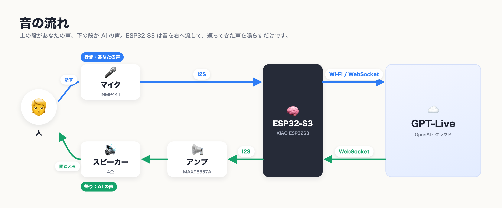
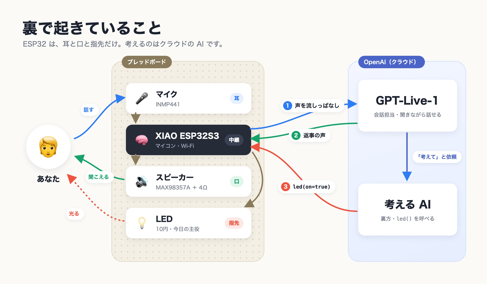

# ai-lchika — AI時代の新たなLチカ

ブレッドボードに AI を召喚して、話しかけるだけで LED を光らせます。
Seeed XIAO ESP32S3 と OpenAI の音声モデル **GPT-Live-1** を使った、最小構成のボイスアシスタントです。

▶ デモ動画: https://x.com/monoradio102/status/2105485178928066602

> 「10037 が素数だったら LED をつけてください」
> 「わかりました。調べます。……素数でした。LED をつけました。」

- 赤いボタンを押すと AI が来ます（GPT-Live のセッションが始まります）
- 話しかけると、AI が声で答えます
- 「LED をつけて」と頼んだり、「〜だったら LED をつけて」と条件を出したりすると、AI が自分で考えて LED を操作します
- 「お帰りください」と言うか、ボタンをもう一度押すと AI が帰ります。30 秒黙っても帰ります

[English summary](#english)

## 用意するもの

| 部品 | 例 |
| --- | --- |
| マイコン | [Seeed Studio XIAO ESP32S3](https://akizukidenshi.com/catalog/g/g118078/)（PSRAM 付き） |
| I2S マイク | [INMP441 モジュール](https://www.amazon.co.jp/dp/B0CCMFX3DC)（ICS-43434 も可） |
| I2S アンプ | [MAX98357A モジュール](https://electronicwork.shop/items/66d2ea608c0c272916d9ec3d) |
| スピーカー | [3W 4Ω](https://www.amazon.co.jp/dp/B0DBZS4ZJN) |
| LED ＋ 抵抗 | [5mm 赤色 LED](https://akizukidenshi.com/catalog/g/g112605/) ＋ [220Ω](https://akizukidenshi.com/catalog/g/g125221/) |
| スイッチ | [タクトスイッチ](https://akizukidenshi.com/catalog/g/g103646/) |
| その他 | [ブレッドボード](https://akizukidenshi.com/catalog/g/g100315/)、[ジャンパーワイヤ](https://akizukidenshi.com/catalog/g/g130088/)、USB-C ケーブル |

ほかに OpenAI の API キーが必要です。

## 配線

| XIAO | つなぐ先 |
| --- | --- |
| 5V | アンプ VIN |
| 3V3 | マイク VDD |
| GND | マイク GND・L/R、アンプ GND、スイッチ、LED のカソード |
| D1 (GPIO2) | マイク SCK ＋ アンプ BCLK |
| D2 (GPIO3) | マイク WS ＋ アンプ LRC |
| D3 (GPIO4) | マイク SD |
| D4 (GPIO5) | アンプ DIN |
| D5 (GPIO6) | スイッチ（もう片方は GND） |
| D7 (GPIO44) | 220Ω → LED のアノード（長い足） |

- マイクの L/R は GND につなぎます（左チャンネル）
- アンプの SD・GAIN はつながなくて大丈夫です

## 書き込み

1. Arduino IDE にボード「esp32 by Espressif Systems」（3.x）を入れます
2. ライブラリマネージャで次の 2 つを入れます
   - WebSockets（Markus Sattler）
   - ArduinoJson（Benoit Blanchon）
3. ボードは **XIAO_ESP32S3**、ツールの **PSRAM を「OPI PSRAM」** にします
4. `summon/summon.ino` を開いて書き込みます

## 初期設定

1. 初回は ESP32 が Wi-Fi「`AI-Summon-XXXX`」を出します（パスワード `summon123`）
2. スマホでつないで `http://192.168.4.1` を開きます
3. 自宅の Wi-Fi と OpenAI の API キーを入れて保存すると、再起動して準備完了です

以降は同じ Wi-Fi から `http://summon.local` を開くと、状態・会話ログ・課金秒数・マイクの音量が見られます。
API キーはソースコードではなく、ESP32 の中（NVS）に保存されます。

## 仕組み

- ESP32 はマイクの音を WebSocket で GPT-Live に流し続け、返ってきた声をスピーカーで鳴らします
- LED の操作は、GPT-Live が裏のモデルに任せます（Responses delegation）。裏のモデルが `led(on)` 関数を呼ぶと、ESP32 が LED をつけたり消したりします
- スピーカーとマイクが近いので、AI が話している間はマイクの代わりに無音を送ります（半二重）

## 料金と注意

- GPT-Live は**つないでいる時間ずっと課金**されます（1 分あたり 0.05 ドル、黙っていても課金）。このため「お帰りください」・ボタン・30 秒の無言・5 分の上限のどれかで、必ずセッションを閉じるようにしています
- 裏で考えるモデルの料金は別にかかります
- この作品専用の API キーを作り、OpenAI のプロジェクトに予算の上限を設定してください。ESP32 の中のキーは、取り出そうと思えば取り出せます
- Web 画面にはパスワードがありません。自宅の Wi-Fi の中だけで使ってください

## 参考

- [GPT-Live 1（OpenAI）](https://developers.openai.com/api/docs/models/gpt-live-1)
- [GPT-Live WebSocket ガイド](https://developers.openai.com/api/docs/guides/voice-websockets)
- [GPT-Live のデリゲーションとツール](https://developers.openai.com/api/docs/guides/live-delegation)

## English

**ai-lchika** ("LED blink for the AI era") is a minimal voice assistant on a breadboard: Seeed XIAO ESP32S3 + an I2S mic (INMP441) + an I2S amp (MAX98357A) + one LED, talking to OpenAI **GPT-Live-1** over WebSocket.

- Press the button to summon the AI, then just talk.
- Ask it to switch the LED, or give it a condition ("if 10037 is prime, turn on the LED"). A delegated backend model reasons about it and calls `led(on)` on the device.
- Say goodbye, press the button again, or stay quiet for 30 s to close the session. GPT-Live bills per second of open session, silence included.

Setup: install the esp32 board package (3.x), the *WebSockets* (Markus Sattler) and *ArduinoJson* libraries, select **XIAO_ESP32S3** with **PSRAM: OPI PSRAM**, and flash `summon/summon.ino`. On first boot, join the `AI-Summon-XXXX` Wi-Fi (password `summon123`), open `http://192.168.4.1`, and enter your Wi-Fi and OpenAI API key. Use a dedicated key with a budget limit.

## License

[MIT](LICENSE)
